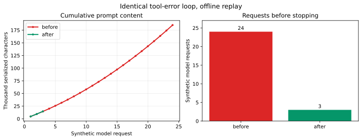

[English](README.md) | **简体中文**

# ArcBench Agent

[](https://github.com/Die4U23/arcbench-agent/actions/workflows/ci.yml)

面向**需求驱动 Web 应用开发**的 Python Agent：读取需求文档，通过显式规划、工具驱动实现、验证、有界修复和候选交付，把需求转为可运行应用。

项目目标是跨业务复用同一套开发流程，ARC-Bench 提供任务与评测环境。订票网站是首个取得正式平台验收结果的样例，跨任务自主完成仍是持续验证的工程目标。项目起源于 **CS3604**。

## 能做什么

- **按需求编排**：将 YAML 或 Markdown 归一化为需求树，分别追踪设计、实现和本地验证状态。
- **工具驱动实现**：浏览和编辑项目文件，进行唯一匹配的文本替换，把具体构建与测试失败送回修复流程。
- **分层验证**：构建与测试、带源码证据的需求审核、公开案例回归，以及适用任务的浏览器与视觉检查。本地通过不等于平台正式验收通过。
- **限制无效循环**：请求、token、工具调用和实现轮数限制；重复失败与无进展保护；保留候选检查点用于交付。
- **可观察的上下文复用**：稳定消息前缀、连续工具轮次、有界历史压缩，以及服务商返回的缓存命中/未命中计数。不保证缓存命中。
- **隔离生成代码执行**：生成的脚本与浏览器在短生命周期的离线 Linux 容器中运行，使用经审查的依赖缓存，不静默回退到宿主机。

设计背景：[需求文档](docs/PRD.md) · [技术选型](docs/TECH_SELECTION.md) · [性能方法](docs/PERFORMANCE_REPORT.md)。

## 架构

```text
YAML / Markdown requirements
            |
            v
    Requirement tree ---> Orchestrator ---> Runtime events / delivery report
                               |
                  Plan -> Implement -> Verify -> Bounded repair
                               |          |
                 Model + file tools       v
                               |    Offline Docker sandbox
                               |    build / tests / browser
                               |          |
                               +---- evidence and failures
                                          |
                              Host-side model review
```

宿主机负责编排和模型 API 调用；生成程序在沙箱内执行，截图返回宿主机进行模型评审。“离线”指生成代码的执行环境，不代表模型 API 无需联网。[执行边界与残余风险](docs/dev/docker-execution.md)。

## 泛化方向与本地进展

项目希望复用同一套需求理解、规划、实现、验证和交付流程，覆盖笔记、知识库、问答、电商及出行等不同业务。任务的业务事实应来自需求、数据和测试输入。正式泛化目标是：**同一冻结 Agent 从干净工作区自主完成不同任务，并分别取得完整验收结果**。

当前已发布入口仍使用 Flash，并保留订票 Demo 的专用兼容路径。下列通用竞赛链路已在本地工作区实现，但**尚未随本次文档更新发布其代码**：

| 本地开发中的通用机制 | 具体内容 |
| --- | --- |
| 任务输入契约 | 固定需求、公测、helper 和参考图哈希；保留祖先约束、正文义务、依赖与数据生命周期 |
| 依赖规划与上下文分区 | 按原子业务流程拓扑调度，提供可检索来源；审核结论绑定已读取的当前源码 |
| 有状态验证世界 | 显式 origin、存储、run ID、seed 与业务时钟；仅预置 SEED，通过独立 SQL/HTTP 观察核对实际状态 |
| 修复与候选恢复 | 用完整案例身份比较新增/丢失/未执行集合；恢复源码后重建世界并完整重测 |
| 持久预算 | 按 campaign、任务和阶段预留/结算请求、token、工具、金额及时间；逐请求重新核对计费来源和有效期 |

截至 **2026-10-27**，为核对初始化、业务状态与原始公测链路，已完成五个**手工本地参考应用**：

| 参考应用 | 业务类型 | 本地公开案例 | 公开 / 标称数量 |
| --- | --- | --- | --- |
| Keep | 笔记管理 | 33/33 通过 | 33/33 |
| BookStack | 知识库 | 35/35 通过 | 35/36，差额保留 |
| Stack Overflow | 问答社区 | 66/66 通过 | 66/68，差额保留 |
| PrestaShop | 电商 | 86/86 通过 | 86/86 |
| 12306 | 铁路出行 | 142/142 通过 | 142/142 |
| Ctrip | 综合出行 | 未执行 | 152/153，差额保留 |

五个参考应用共通过 362 条现有公测，均无跳过和重试。BookStack、Stack Overflow 的原始整套 verifier 仍因数量差额保留未通过状态。六任务合计公开 514 条、标称 518 条，四条差额尚未解释。[机器可读进展摘要](docs/releases/local-reference-public-cases-20261027.json) 保留本地状态、产物哈希与原始报告位置；原始运行产物未随本次文档发布。

这些参考应用没有经过 Agent 自动生成路径，**不能作为跨任务自主完成率或正式平台成绩**。六任务真实生成与正式验收仍待完成；线上 Runner 的部署、隔离/初始化合同与实际路由计费仍需补证。本阶段参考应用验证未启动被测 Agent 的真实模型调用、付费评测或平台提交。

## 已记录的结果

### 最新冻结验收：2026-10-20

Railway Ticket Booking Demo 在 [提交 3e5f0811cfe4](https://arc-bench.com/playground/task-bank/web/ticketbooking/submissions/3e5f0811cfe4) 的 Stage 3 中通过 **30/30**。保留源码为 [`f75792c`](https://github.com/Die4U23/arcbench-agent/commit/f75792c4a7b4377b4628163abd2c3445550a21e8)，冻结标签为 [`ticketbooking-flash-30of30-20261020`](https://github.com/Die4U23/arcbench-agent/tree/ticketbooking-flash-30of30-20261020)。

| 指标 | 冻结运行值 |
| --- | ---: |
| 正式案例通过数 | 30 / 30 |
| 模型 | deepseek-flash |
| 完整响应／请求尝试 | 113 / 113 |
| 输入／输出 token | 4,492,045 / 176,392 |
| 总 token | 4,668,437 |
| 缓存命中／未命中输入 token | 4,097,280 / 394,765 |
| 整轮输入缓存命中率 | **91.21%** |
| 平台显示耗时 | **28m21s** |
| 最终前端／后端自测 | 18 / 18；10 / 10 |
| 最终本地公开回归／Chromium 探针 | 32 / 32；4 / 4 |

[版本证据](docs/releases/ticketbooking-formal30-flash-20261020.json) 记录包身份、用量核对和来源。113 次尝试均有完整响应，用量与最终汇总一致，但未核验服务商账单。本地检查与正式验收属于不同证据层次。本地 32/32 依据最终交付报告，而非更早的未确认候选 27/32 日志。

本地 Agent ZIP 为 125,604 字节，SHA-256 为 `8a2ec0f1c5d680426d5d6b514af852a745c66a369e144121dfd9dd6f3931f066`。忽略换行差异后，包内容与冻结源码相符；服务端上传包哈希不可得。归档没有提供可靠的全程构建／修复累计次数或实际金额。

这是一个任务的一次冻结运行，**不是当前 main 重跑成绩，也不是受控 A/B 改善结论**。特别是该冻结源码早于当前 Docker 沙箱，不能用这次正式结果验证后续隔离实现。下方 2026-10-14 记录保留为历史证据，两轮数字差异不构成受控性能对照。


### 较早冻结验收：2026-10-14

Railway Ticket Booking Demo 在 [提交 35128ac54f45](https://arc-bench.com/playground/task-bank/web/ticketbooking/submissions/35128ac54f45) 的 Stage 3 中通过 **30/30**。

| 指标 | 归档值 |
| --- | ---: |
| 正式案例通过数 | 30 / 30 |
| 规划与生成模型 | deepseek-flash |
| 完整模型响应 | 209 次 |
| 输入 token | 8,286,426 |
| 输出 token | 219,017 |
| 总 token | 8,505,443 |
| 整轮输入缓存命中率 | 86.46% |

[机器可读版本证据](docs/releases/ticketbooking-formal30-flash-20261014.json) 记录了用量与本地包哈希。平台没有公开上传 ZIP 的哈希，因此未完成服务端包身份的哈希核验。

这是一次冻结提交的成功记录，**不是当前 main 的重跑成绩，也不是通用任务完成率**。交付前本地自测仍有失败，恢复可交付候选后才通过正式验收；冻结包中的需求节点追踪也未完整回填。后续追踪、隔离和其他修复不能直接继承这次成绩。归档中的 99.44% 仅代表稳定请求片段，不是整轮缓存命中率。

### 历史离线回放：停止重复失败的工具调用

2026-09-28 的确定性归档实验持续返回相同的文件缺失错误。旧流程耗尽 24 次请求额度；重复失败保护在第 3 次请求后停止。

| 回放 | 模拟请求数 | 累计序列化提示字符 |
| --- | ---: | ---: |
| 加入保护前 | 24 | 185,070 |
| 重复失败保护 | 3 | 14,758 |

[](docs/performance/stalled-tool-data.json)

折线图使用**假模型响应和序列化字符数，不是服务商 token**。它展示停止策略，不代表任务成功、实测 API 节省、耗时或缓存命中率。基线标为 `pre-stall-70b3c36.zip`，保护版本仅标为 `arc_agent`，没有固定提交号。这是历史证据，不是当前 main 基准。[原始数据](docs/performance/stalled-tool-data.json) · [方法与其他曲线](docs/PERFORMANCE_REPORT.md)。

## 快速开始

### 1. 准备控制端

使用 [.python-version](.python-version) 固定的 **64 位 Python 3.12.6**。Windows：

```powershell
.\scripts\setup.ps1
```

脚本检查 Python 版本并准备虚拟环境。运行依赖见 [requirements.txt](requirements.txt)；ARC-Bench Runtime SDK 随 [arcbench-agent-runtime/](arcbench-agent-runtime/) 提供。[.nvmrc](.nvmrc) 固定本地开发使用的 Node 版本；沙箱镜像自带经审查的工具链。

### 2. 构建可信执行镜像

需要本地 Docker 引擎，且处于 **Linux 容器模式**：

```sh
docker info --format '{{.OSType}}'
docker build -f sandbox/Dockerfile -t arcbench-sandbox:1 .
```

只构建仓库中经审查的 Dockerfile，不构建模型生成的 Dockerfile。镜像构建阶段下载依赖；生成代码执行阶段使用 `--network none` 和预置缓存。镜像缺失、包版本未缓存或资源超限均明确失败。Agent 不会安装 Docker、启用 WSL 或修改宿主机安全设置。

运行前阅读 [Docker 配置与限制](docs/dev/docker-execution.md)。请使用独立的生成项目目录，不使用个人主目录或含密钥的仓库。

### 3. 查看命令行接口

```powershell
.\.venv\Scripts\python.exe main.py --help
```

帮助命令不调用模型。使用确定性示例模式时，需要提供实际存在的需求目录和独立输出目录，再添加 `--demo`。setup 脚本打印的旧 `demo/requirements` 路径不包含在当前仓库中。示例行为不能用作模型驱动任务性能的证据。

### 4. 接入 ARC-Bench

上传入口为 `main.py`，依赖声明为 `requirements.txt`。Runner 提供 `OPENAI_API_KEY`、`OPENAI_BASE_URL` 和 `MODEL`，不要提交凭据。Agent 读取并修改显式 `--output-dir` 内的目标项目，不用模板覆盖它。

需求目录支持 `requirements.yaml`、`README.md` 或 `requirements.md`，同时存在时优先 YAML。含图片参考的任务要求所配置的 Flash 端点支持图像输入。部署环境还必须支持本地 Linux Docker 执行边界，不能假定所有托管 Runner 都提供 Docker。

## 运行控制

| 控制项 | 当前上传入口行为 |
| --- | --- |
| 模型 | 仅 `deepseek-flash`；`MODEL`、`VISUAL_MODEL`、`VISUAL_REVIEW_MODEL` 设置为其他模型时，在请求前拒绝 |
| 整轮额度 | `main.py` 固定 10,000,000 总 token 和 250 次模型请求，覆盖同名环境变量 |
| 模型请求期限 | 300 秒；关闭 SDK 自动重试 |
| 额外实现限制 | `--max-model-turns` 和 `--max-tool-calls` |
| 交付预留 | 最多预留 400,000 token 和 3 次请求，提前进入收尾 |

用量在请求前后检查。最后一次响应仍可能越过 token 阈值，**这些限制不是严格的金额预算上限**。模型响应中断时保留未知用量，不能当成成功且零费用的调用。旧文档或库配置中的较低默认值不能覆盖 `main.py`。

可交付的本地候选仍可能包含明确报告的自测失败；构建、依赖或启动失败则阻止这条交付路径。`.arc/delivery-report.json` 区分本地验证、交付就绪和待执行的正式验收。构建成功或进程正常退出都不等于 Stage 3 通过。

## 验证如何分层

- **Python 回归**：检查编排、传输、工具边界、审核证据和结果报告。
- **真实 Docker 集成**：构建可信镜像，覆盖隔离脚本、离线依赖、清理、文件系统边界及浏览器/服务端执行。
- **任务本地检查**：验证生成应用。订票任务的公开案例适配器和额外探针是本地门槛，不是完整的官方 Playwright 评测器。
- **平台 Stage 3**：外部正式验收，成绩绑定具体提交包。

```sh
python -m unittest discover -s tests -v
```

CI 为可信测试样例安装 Chromium；独立 Docker 任务设置 `ARCBENCH_RUN_DOCKER_TESTS=1` 并运行 `tests/test_docker_integration.py`。Mock 测试不能单独证明隔离有效，Linux CI 也不等于完成了 Windows Docker Desktop 运行验证。见 [CI 配置](.github/workflows/ci.yml) 与 [验证范围](docs/dev/docker-execution.md#verification)。

## 当前边界

- 正式归档成绩覆盖一个任务的特定冻结包，尚无已建立的多任务完成率或受控 Claude Code 对照。
- 离线字符曲线不能证明真实 token、缓存、耗时或成本提升。
- 离线 npm 缓存只支持经审查的精确版本，不支持任意联网安装依赖。
- Docker 是实用隔离边界，不是绝对安全证明。引擎与镜像必须可信；任意宿主机或控制器崩溃后可能仍需人工清理遗留容器。
- 生成代码能破坏其获准访问的项目文件。本地测试与报告不是防篡改证明。
- 视觉验收依赖端点的图像能力和有效浏览器证据，不能用仅构建成功代替。

## 目录结构

```text
main.py                    Flash-only 上传入口与固定整轮控制
agent/requirements.py      YAML / Markdown 需求归一化
agent/orchestrator.py      规划、实现、验证与修复
agent/llm.py                模型调用与工具对话
agent/tools.py              项目文件工具与执行路由
agent/verify.py             本地验证与结果收集
agent/visual_acceptance.py  浏览器证据与视觉评审
sandbox/                   可信离线镜像、worker、依赖缓存
arcbench-agent-runtime/    随仓库提供的 ARC-Bench Runtime SDK
tests/                     Python 回归与 Docker 集成
docs/releases/             冻结提交证据
docs/performance/          历史回放数据与曲线
```

## 后续方向

1. 持续区分正式提交证据、当前实现与本地回归。
2. 在匹配的真实任务上测量缓存效率、token、耗时和成本，再判断是否改善。
3. 在保留明确预算与执行边界的前提下扩大任务覆盖。

## 项目背景

本项目用于 **CS3604**。ARC-Bench 提供任务与评测环境，starter 提供随仓库分发的 Runtime SDK；本仓库实现 Agent 的编排与验证流程。

进一步阅读：[PRD](docs/PRD.md) · [技术选型](docs/TECH_SELECTION.md) · [性能报告](docs/PERFORMANCE_REPORT.md) · [执行安全](docs/dev/docker-execution.md)。
